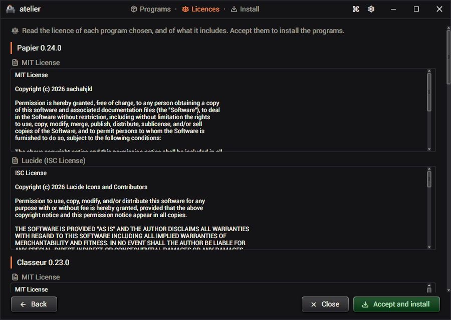
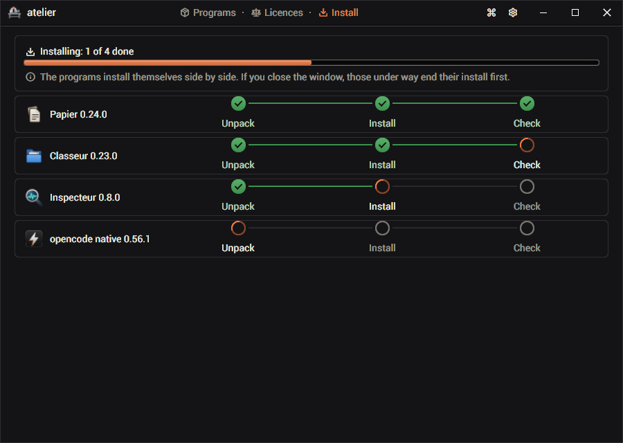
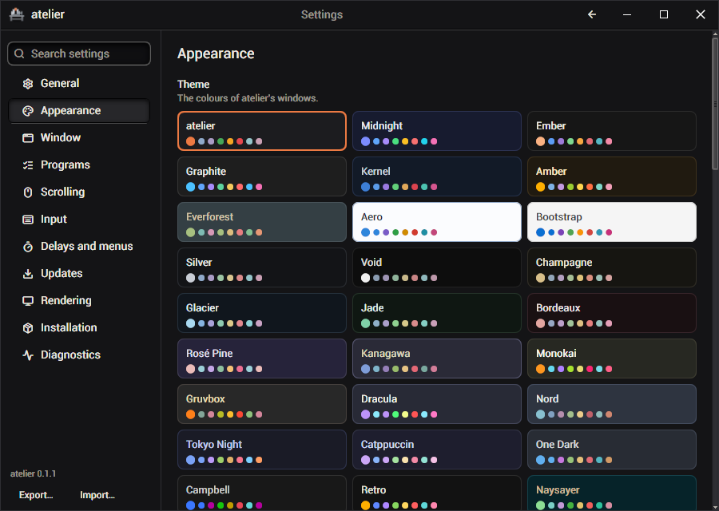
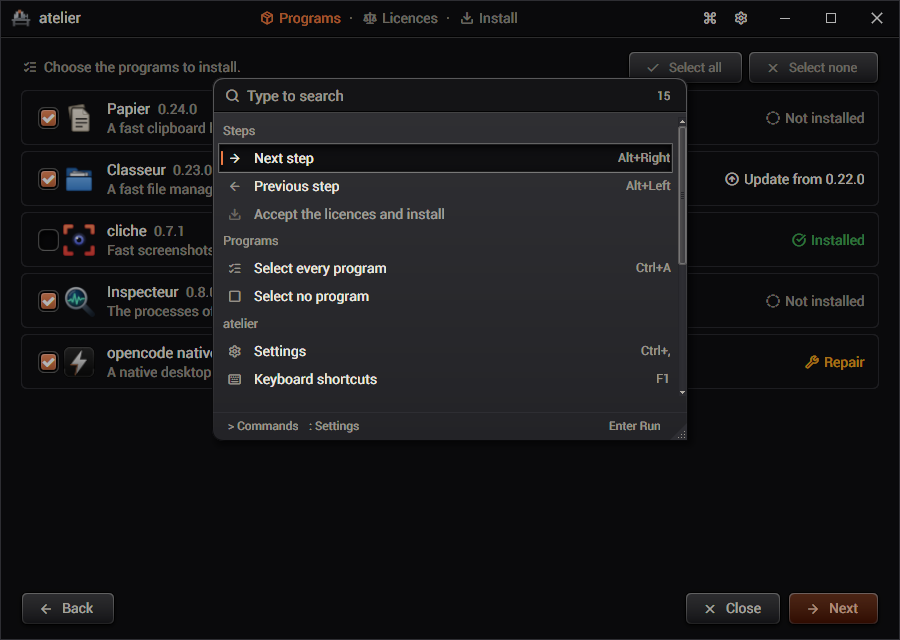

<p align="center"></p>

<h1 align="center">atelier</h1>

<p align="center"><b>The working man's tools, by Froment Software.</b></p>

<p align="center">
<a href="https://github.com/sachahjkl/atelier/actions/workflows/ci.yml"></a>
<a href="https://github.com/sachahjkl/atelier/releases/latest"></a>
<a href="https://atelier.froment.software/"></a>
<a href="LICENSE"></a>
</p>

Every desktop program of [Froment Software](https://froment.software) in one download. Choose the programs, read their
licences, and they install at once.


## What it carries

| Program | What it does | Systems |
|---|---|---|
| [papier](https://papier.froment.software/) | A fast clipboard history, searched as you type. | Linux, Windows |
| [classeur](https://classeur.froment.software/) | A fast file manager you drive from the keyboard. | Linux, Windows |
| [cliche](https://cliche.froment.software/) | Fast screenshots and screen recordings, shared at once. | Linux, Windows |
| [inspecteur](https://inspecteur.froment.software/) | The processes of your machine, at a glance. | Linux |
| [opencode native](https://ocn.froment.software/) | A native desktop client for opencode. | Linux, Windows |

Each release of atelier carries the latest release of each program. Its notes say which versions.

## How it works

1. **Programs**: each program says what is installed: nothing yet, an older version (ticked: it is updated), or the same
   version (not ticked).
2. **Licences**: the licence of each program you chose, and of what it includes (icons, fonts).
3. **Install**: the programs install themselves side by side, each with its steps (unpack, install, check), as its own
   Install button does: its folder in your
   profile, its menu entry, its uninstaller (Settings > Apps on Windows). No administrator.
4. **Done**: a button opens each program. Each one updates itself from then on.

| | |
|---|---|
|  |  |
| The licences of what you chose | Side by side, each with its steps |

## atelier itself

atelier is one more program of the suite: its own title bar, its settings (Ctrl+,), its command palette (Ctrl+K).

- **It installs itself** with the programs it carries (the settings' Installation page, or `atelier --install`): open
  it again from the menu to add a program later. On Windows it offers it at its first start.
- **It updates itself** once installed: a new release brings the new versions of the programs too.
- **Its settings** are the suite's common ones (theme, language, text, window, updates) and whether the programs start
  ticked. [docs/configuration.md](docs/configuration.md) lists them.

| | |
|---|---|
|  |  |
| The settings | The command palette |

## Download

From the [releases](https://github.com/sachahjkl/atelier/releases/latest):

- **Windows** 10 and 11 (x64): `atelier-<version>-windows-x64.exe`. Start it.
- **Linux** (x64): `atelier-<version>-linux-x64`. Make it executable (`chmod +x`), then start it. The programs need a
  Wayland or X11 desktop, Vulkan and fontconfig.
- **NixOS**: Nix installs each program from its flake (`nix profile add github:sachahjkl/papier`). atelier shows the
  line of each one.

From a terminal, without a window:

```sh
./atelier-*-linux-x64 list                  # the programs it carries, their version, what is installed
./atelier-*-linux-x64 install papier classeur
./atelier-*-linux-x64 install all
./atelier-*-linux-x64 --install             # atelier itself, in your profile, with its menu entry
```

## Build

Odin, on [gui_toolkit](https://github.com/sachahjkl/gui_toolkit) (the submodule `ext/gui_toolkit`).
[docs/development.md](docs/development.md) says the steps; in short:

```sh
git clone --recursive https://github.com/sachahjkl/atelier && cd atelier
nix develop
./build.sh                                   # build/atelier, no programs carried
odin run tools/ateliertool -collection:gt=ext/gui_toolkit/src -out:build/ateliertool -- bundle
build/atelier --bundle build/bundle-linux-x64.zip
```

## Licence

atelier is MIT ([LICENSE](LICENSE)). Each program it carries has its own licence, which atelier shows before it
installs anything.
