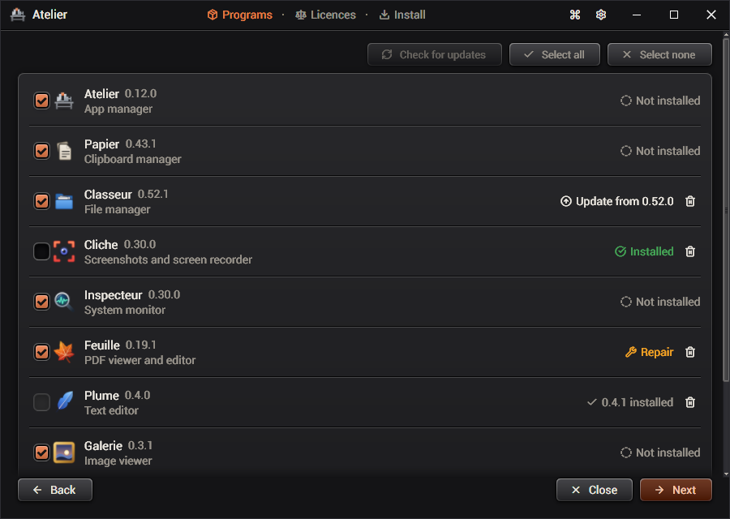
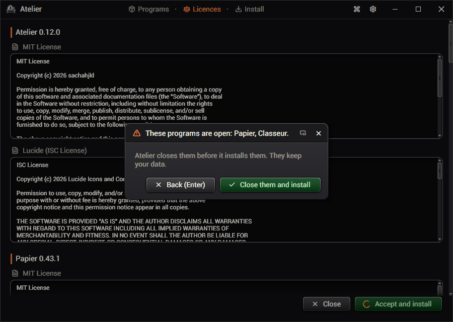
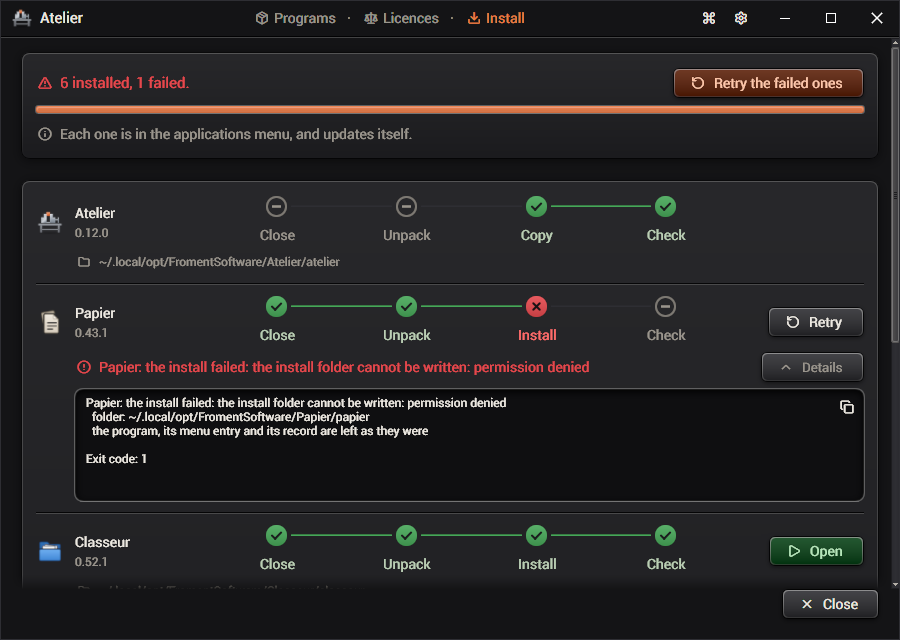
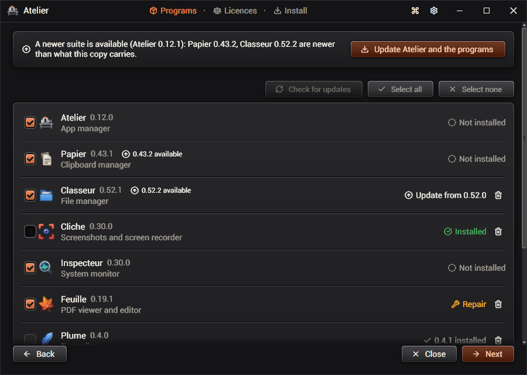

<p align="center"></p>

<h1 align="center">Atelier</h1>

<p align="center"><b>Installer and updater for Froment Software apps.</b></p>

<p align="center">
<a href="https://github.com/sachahjkl/atelier/actions/workflows/ci.yml"></a>
<a href="https://github.com/sachahjkl/atelier/releases/latest"></a>
<a href="https://atelier.froment.software/"></a>
<a href="LICENSE"></a>
</p>

Every desktop program of [Froment Software](https://froment.software) in one download. Choose the programs, read their
licences, and they install at once.



## What it carries

| Program | What it does | Systems |
|---|---|---|
| [Papier](https://papier.froment.software/) | Clipboard manager | Linux, Windows |
| [Classeur](https://classeur.froment.software/) | File manager | Linux, Windows |
| [Cliche](https://cliche.froment.software/) | Screenshots and screen recorder | Linux, Windows |
| [Inspecteur](https://inspecteur.froment.software/) | System monitor | Linux, Windows |
| [Feuille](https://feuille.froment.software/) | PDF viewer and editor | Linux, Windows |
| [Plume](https://plume.froment.software/) | Text editor | Linux, Windows |
| [Galerie](https://galerie.froment.software/) | Image viewer | Linux, Windows |
| [Ardoise](https://ardoise.froment.software/) | Terminal | Linux, Windows |
| [Tower](https://tower.froment.software/) | OpenCode client | Linux, Windows |

Each release of Atelier carries the latest release of each program. Its notes say which versions.

## How it works

1. **Programs**: each program says what is installed: nothing yet, an older version (ticked: it is updated), or the same
   version (not ticked). Installed programs also have an Uninstall button on their row (settings and data stay).
2. **Licences**: the licence of each program you chose, and of what it includes (icons, fonts).
3. **Install**: a program that is open is named first, and closed once you agree. Then the programs install themselves
   side by side, each with its steps (close, unpack, install, check), as its own Install button does: its folder in your
   profile, its menu entry, its uninstaller (Settings > Apps on Windows). No administrator.

   On the same screen, each program's line then shows its result: Open and its folder once it is installed, or the
   reason of a failure, its whole output and Retry. Each program updates itself from then on.

| | |
|---|---|
|  |  |
| The licences of what you chose | Side by side, each with its steps |
|  |  |
| A program that is open is closed first | A failed install says why, on its own line |

## Atelier itself

Atelier is one more program of the suite: its own title bar, its settings (Ctrl+,), its command palette (Ctrl+K).

- **It installs itself** with the programs it carries: it is the first line of the programs, ticked when it is not
  installed (also the settings' Installation page, or `atelier --install`). Open it again from the menu to add a
  program later.
- **It updates itself** once installed: a new release brings the new versions of the programs too. "Check for updates"
  on the programs' step names what a newer Atelier carries; "Update Atelier and the programs" updates Atelier, then
  opens it again with the programs to update ticked.

  
- **Its settings** are the suite's common ones (theme, language, text, window, updates) and whether the programs start
  ticked. [docs/configuration.md](docs/configuration.md) lists them.

| | |
|---|---|
|  |  |
| The settings | The command palette |

## Download

From the [releases](https://github.com/sachahjkl/atelier/releases/latest):

- **Windows** 10 and 11 (x64): `atelier-<version>-windows-x64.exe`. Start it.
- **Linux** (x64): `atelier-<version>-linux-x64`. Make it executable (`chmod +x`), then start it. The programs need a
  Wayland or X11 desktop, Vulkan and fontconfig.
- **NixOS**: Nix installs each program from its flake (`nix profile add github:sachahjkl/papier`). Atelier shows the
  line of each one.

From a terminal, without a window:

```sh
./atelier-*-linux-x64 list                  # the programs it carries, their version, what is installed
./atelier-*-linux-x64 install papier classeur
./atelier-*-linux-x64 install all
./atelier-*-linux-x64 install all --close     # close the programs that are open first (else they are left as they are)
./atelier-*-linux-x64 uninstall papier        # uninstall one program, or all (--close closes open programs first)
./atelier-*-linux-x64 --install             # atelier itself, in your profile, with its menu entry
```

In the window, a program that is open is named before anything starts: "Close them and install" closes it, then
installs it. A failed install has a Retry button.

## Build

Odin, on [gui_toolkit](https://github.com/sachahjkl/gui_toolkit) (the submodule `ext/gui_toolkit`).
[docs/development.md](docs/development.md) says the steps; in short:

```sh
git clone --recursive https://github.com/sachahjkl/atelier && cd atelier
nix develop
./build.sh                                   # build/atelier, no programs carried
odin run tools/ateliertool -collection:gt=ext/gui_toolkit/src -out:build/ateliertool -- bundle
build/atelier --bundle build/bundle-linux-x64.zip
```

## Licence

Atelier is MIT ([LICENSE](LICENSE)). Each program it carries has its own licence, which Atelier shows before it
installs anything.
